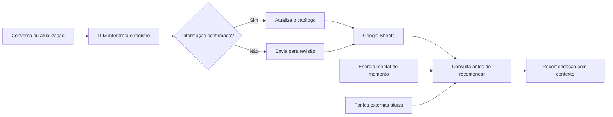

# Catálogo de Entretenimento com LLM

Eu tinha filmes, séries, animes, documentários e jogos em listas separadas. Quando pedia uma recomendação, aparecia coisa que já tinha visto, abandonado ou avaliado mal. E só citar um título já podia virar registro errado.

A ideia foi fazer a IA consultar meu histórico antes de recomendar. No MVP, organizei o catálogo no Google Sheets e os materiais de apoio no Drive. As regras dizem o que conferir antes de sugerir alguma coisa.

O MVP já foi usado com uma base funcional. Aqui estão a arquitetura, as regras e exemplos fictícios. Meu histórico, minhas notas e os links privados ficam fora da versão pública.

## O que o MVP resolve

- reúne filmes, séries, animes, documentários e jogos em um catálogo;
- diferencia o que foi concluído, pausado, abandonado ou ainda está pendente;
- mantém progresso, nota, prioridade e próxima ação;
- atribui a cada conteúdo um nível de energia mental necessária;
- registra títulos alternativos para reduzir duplicidades;
- separa informação confirmada de algo que ainda precisa de validação;
- consulta o histórico antes de fazer uma recomendação;
- usa a avaliação pessoal como sinal principal de preferência;
- consulta fontes atuais antes de afirmar disponibilidade, data ou plataforma.

Também considero **minha energia no momento**: baixa, média ou alta. Se estou cansado, quero algo fácil de acompanhar. Se estou disposto, posso escolher algo que exija mais atenção. A recomendação precisa levar isso em conta.

## Como funciona

Primeiro consulta o catálogo. O que já concluí não volta como novidade. O que abandonei ou avaliei mal conta contra sugestões parecidas. E `precisa_confirmar` não significa assistido.

Energia é o esforço que aquele conteúdo exige de mim, não uma nota de qualidade. Dentro da mesma categoria pode ter coisa leve, moderada ou intensa.

## Estrutura da base

| Aba | Uso |
| --- | --- |
| `Catálogo` | Base principal com todos os registros |
| `Resumo` | Indicadores por estado e categoria |
| `Regras` | Critérios de atualização e recomendação |
| `Fontes` | Ordem das fontes externas |
| `Como usar` | Procedimento para consultar e atualizar |
| `Listas` | Valores aceitos para estado, tipo e prioridade |
| `Quero ver` | Visão dos itens pendentes |
| `Assistidos` | Visão do que foi concluído |
| `Em andamento` | Visão do consumo atual |
| `Revisão` | Registros que precisam de confirmação |

O modelo de dados está em [docs/modelo-de-dados.md](docs/modelo-de-dados.md). O arquivo em [examples/catalogo.csv](examples/catalogo.csv) usa títulos inventados para mostrar o formato sem publicar meu histórico.

## Regras do catálogo

- **O histórico vem antes da recomendação.** A LLM consulta a base antes de sugerir.
- **Minha nota tem mais peso.** Avaliações externas ajudam a explicar o risco, mas não substituem o gosto registrado.
- **A energia do momento filtra a lista.** O assistente cruza minha disposição atual com a energia atribuída a cada conteúdo.
- **Citado não significa assistido.** Estados incertos permanecem separados até uma confirmação.
- **Disponibilidade exige fonte atual.** Catálogos de streaming e datas mudam.
- **Títulos alternativos são preservados.** Isso reduz duplicidade entre nomes em português, nomes originais e abreviações.
- **A recomendação precisa explicar a relação.** O resultado mostra quais sinais do histórico sustentam a sugestão.

## Engenharia de prompt

A ordem é simples: entender o pedido, localizar o título, conferir duplicidades e estado. Só depois atualizar a base ou recomendar.

Estado e confiança ficam separados. Um item pode estar em `quero_ver` e ainda ter o título exato em dúvida. Nesse caso, a dúvida precisa continuar registrada.

O desenho está detalhado em [docs/engenharia-de-prompt.md](docs/engenharia-de-prompt.md).

## Situação atual

A planilha foi organizada com base principal, visões por estado, resumo, regras, fontes e fila de revisão. O histórico serve para consultar o que já registrei e evitar recomendações repetidas ou incompatíveis.

Os próximos testes são de duplicidade, identificação de títulos e atualização de progresso. Também falta medir a diferença nas recomendações usando notas e rejeições de forma consistente.

## Arquivos privados de trabalho

O catálogo e o backup foram exportados para o [repositório privado projetos-llms](https://github.com/BaianoMaligno/projetos-llms/tree/main/projetos/catalogo-entretenimento/originais/GPT/Entretenimento). O repositório público mantém apenas documentação e exemplos fictícios.

## Documentação

- [Arquitetura](docs/arquitetura.md)
- [Modelo de dados](docs/modelo-de-dados.md)
- [Regras de recomendação](docs/regras-de-recomendacao.md)
- [Engenharia de prompt](docs/engenharia-de-prompt.md)
- [Decisões](docs/decisoes.md)
- [Limitações e próximos testes](docs/limitacoes.md)
- [Segurança e privacidade](SECURITY.md)

## Licença

A documentação e os exemplos podem ser usados como referência. A base pessoal, as avaliações reais e os arquivos privados não fazem parte do projeto público.
